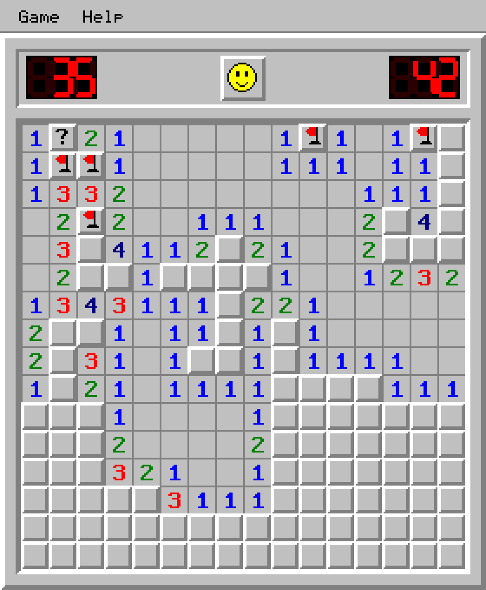
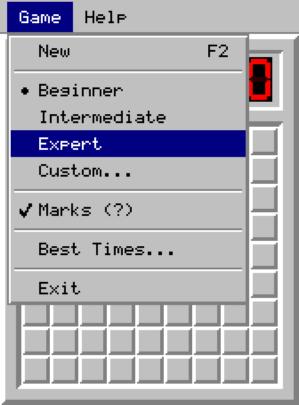

# Saper

Classic Minesweeper, rebuilt from scratch in Zig.

A real native window on macOS, Linux and Windows — no engine, no UI toolkit, no
third-party libraries. Every pixel, from the beveled cells to the LED counters,
is drawn by the game itself.



## Play

Grab a build from the [latest release](../../releases/latest), or run
`zig build run` from source.

| Action | Effect |
| --- | --- |
| Left click | Open a cell |
| Right click | Flag → question mark → clear |
| Left + right together, or middle click | Open everything around a satisfied number |
| Click the smiley, or `F2` | New game |
| `Esc` | Close the open menu or dialog |

The first click is never a mine. The left counter shows mines minus flags, the
right one counts seconds. Win and the last flags are placed for you; lose and
every mine is uncovered, with a red cross on the flags you got wrong.

**Game** has the three standard levels — Beginner, Intermediate, Expert — plus a
custom field up to 30 × 24, question marks on or off, and the best times table.
Records are kept in `~/.saper-scores`.

<p>


</p>

### On macOS

The app is a proper `Saper.app`. Its icon is a layered Icon Composer document, so
macOS 26 renders it with glass, shadow and separate light, dark and tinted
appearances. The window sits on a **Liquid Glass** backdrop where the system
offers one; `--no-glass` gives you a plain window instead.

The board is drawn at the original 16-pixel tile size and scaled up by a whole
number, so it stays sharp on Retina. `--scale 3` if you want it bigger.

## Build

Zig 0.16 is the only requirement. On Linux you also need the X11 headers
(`libx11-dev` or `libX11-devel`).

```sh
zig build run          # play
zig build              # binary in zig-out/bin
zig build test         # unit tests
zig build bundle       # macOS: zig-out/Saper.app
./build-macos-app.sh   # macOS: the same app with a universal binary
```

Cross-compiling needs no extra setup:

```sh
zig build -Dtarget=x86_64-windows-gnu
zig build -Dtarget=aarch64-linux-gnu
zig build -Dtarget=x86_64-macos --sysroot "$(xcrun --show-sdk-path)"
```

## How it works

The game renders into a plain 32-bit framebuffer. Each platform backend does two
things: put that buffer on screen, and report mouse and keyboard events. Nothing
above `platform/` knows which operating system it is running on.

| Backend | Built on |
| --- | --- |
| macOS | Cocoa through the Objective-C runtime, presented via `CALayer` |
| Linux, BSD | Xlib |
| Windows | Win32 and GDI |

```
src/
  main.zig       event loop and command line
  app.zig        the screen: state, menus, dialogs, input, drawing
  game.zig       the rules: board, flood fill, chording, win and loss
  layout.zig     window metrics
  gfx.zig        framebuffer and drawing primitives
  font.zig       5×7 bitmap font
  sprites.zig    tile art and the smiley faces
  widgets.zig    3D borders, buttons, LED counters, text fields
  scores.zig     best times on disk
  png.zig        RGBA PNG encoder used by the icon generator
  icongen.zig    draws the app icon and its layers
  platform/      one file per operating system
```

Because the interface is just pixels in a buffer, it can be checked without a
display at all — which is how the screenshots above were made:

```sh
zig build run -- --dump frame.bmp   # one frame of the current screen
zig build shots                     # a dozen sample screens
zig build icon                      # redraw the icon artwork
```

`assets/build-icons.sh` turns that artwork into `Saper.icns`, the layered
`Assets.car` for macOS 26, and `saper.ico` for Windows.

## Size

Release builds, with nothing to ship alongside them:

| Target | Binary |
| --- | --- |
| macOS arm64 | 199 KB |
| macOS x86_64 | 155 KB |
| macOS universal | 359 KB |
| Windows x86_64 | 490 KB |
| Windows arm64 | 438 KB |
| Linux x86_64 | 182 KB |
| Linux arm64 | 178 KB |

`Saper.app` comes to 1.9 MB, almost all of which is the macOS 26 icon catalogue.

## License

MIT
